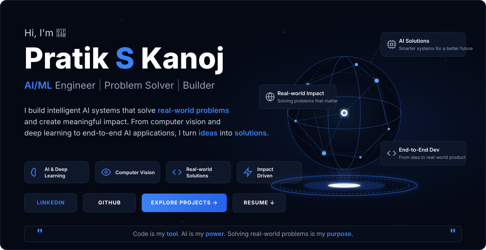

  
  
  
  

  

---

<b>🚀 Executive Summary</b>

 
I am a highly driven <b>Artificial Intelligence & Data Science Engineer</b> specializing in translating complex theoretical research into scalable, production-grade applications. My expertise spans <b>Machine Learning, Deep Learning, Computer Vision</b>, and <b>Generative AI</b>. I am deeply passionate about <b>Healthcare AI</b>, having developed advanced Digital Twin systems and predictive analytics platforms.
  
With a robust full-stack foundation in <b>FastAPI, React</b>, and <b>Python</b>, I architect end-to-end <b>MLOps</b> pipelines deployed on modern <b>Cloud Technologies</b>. I thrive at the intersection of AI research and software engineering, building intelligent systems that solve high-impact, real-world problems.

---

## 👤 About Me

I am a passionate AI Engineer specializing in Machine Learning, Computer Vision, and full-stack integration. I build robust, production-ready AI systems that solve real-world problems. My expertise lies in taking complex Deep Learning architectures and deploying them into scalable, user-centric web applications.

---

## 🎯 Strategic Focus

- 🏥 **Healthcare AI:** Pioneering predictive health telemetry and Digital Twin simulations.
- 👁️ **Computer Vision:** Developing low-latency object detection and anomaly recognition systems.
- 🧠 **Generative AI & RAG:** Architecting LLM-powered knowledge discovery frameworks.
- ⚙️ **MLOps:** Optimizing deep neural network deployments for real-time edge environments.

---

## 💻 Technical Arsenal

### Core AI & Machine Learning

### Frameworks & Libraries

### Software Engineering

---

## 🏆 Interactive Project Showcase

*(Click on a project to expand its technical details)*

<b>🛡️ Stampede Detection AI</b> — <i>Intelligent Crowd Anomaly Detection and Early Warning System</i>

- **Description:** An AI-powered crowd anomaly detection and early warning prototype engineered to identify abnormal crowd density surges, turbulent movement patterns, and stampede precursors from visual video feeds.
- **Problem Statement:** Large-scale public gatherings (festivals, transit hubs, stadiums) face severe crowd crush hazards where manual CCTV surveillance fails to detect localized kinetic turbulence, density build-up, and directional convergence before critical crowd collapse occurs.
- **Technical Approach:** Implements a multi-stage visual perception and risk-fusion pipeline: utilizes YOLOv8 person detection and tracking for spatial crowd density mapping, Gunnar Farneback dense optical flow for kinetic velocity and divergence vector analysis ($\partial u/\partial x + \partial v/\partial y$), a spatial-temporal convolutional autoencoder trained on normal crowd motion benchmarks (UCSD Ped2) for reconstruction-error (MSE) anomaly scoring, and a multi-factor risk scoring engine.
- **Key Implemented Features:**
  - **Crowd Density & Flow Analysis:** Real-time person detection mapped to a 2D density heatmap grid with Gaussian blur, paired with optical flow vectors isolating negative divergence (convergence hotspots).
  - **Spatiotemporal Anomaly Detection:** 10-frame temporal window convolutional autoencoder calculating frame-by-frame Mean Squared Error (MSE) reconstruction loss; flags kinetic movement anomalies when MSE breaches safety thresholds ($\text{MSE} > 0.02$).
  - **Multi-Factor Risk Scoring Engine:** Rule-based fusion combining density rate of change ($d\text{Count}/dt$), venue density thresholds ($>4\text{ people/m}^2$), convergence intensity, and velocity sudden-stop signatures into four severity levels (LOW, MODERATE, HIGH, CRITICAL).
  - **Dual-Channel Emergency Alerting:** Asynchronous notification engine triggering automated outbound Twilio Voice phone calls with Amazon Polly neural TTS (`Polly.Aditi`) and Twilio WhatsApp alerts with incident coordinates.
  - **Command Center Dashboard:** Asynchronous FastAPI backend streaming real-time frame telemetry via Server-Sent Events (SSE) to a React/Vite operator monitoring interface with live telemetry and diagnostic health checks.
- **Technology Stack:** Python, FastAPI, PyTorch, TensorFlow / Keras, OpenCV, Ultralytics YOLOv8, Transformers (VideoMAE), React, Vite, Tailwind CSS, Twilio Voice/WhatsApp API, SQLite / SQLAlchemy.
- **Verified Results:** Evaluated on the UCSD Ped2 crowd anomaly benchmark and staged video sequences; delivers ~2ms video frame decoding, ~12ms Farneback optical flow computation, and ~8ms neural autoencoder inference latency on Apple Silicon hardware.
- **Current Implementation Status:** Functional proof-of-concept prototype. Built as an exploratory risk-fusion and automated alerting architecture tested on benchmark datasets and staged test feeds; it is not a certified or validated public-safety system deployed in venues and requires venue-specific calibration and human-in-the-loop verification before operational emergency dispatch.
- **Link:** [View Repository](https://github.com/PRATIKSK7/falcon-ai)

<b>🧠 ThreadMind</b> — <i>AI-Powered Customer Support Intelligence and RAG Pipeline</i>

- **Description:** An intelligent customer support conversation intelligence and intent routing system engineered to audit, reconstruct, and classify multi-turn customer dialogues with deterministic human escalation safeguards.
- **Problem Statement:** High-volume customer support on public channels (@AmazonHelp) suffers from severe semantic ambiguity across short tweets, high inference costs and latency when routing all traffic to LLMs, and dangerous hallucination risks where generative models invent tracking IDs, refund amounts, or unauthorized policies.
- **Technical Approach:** Combines data pipeline reconstruction across 2.8M customer interactions with a multi-tier classification architecture: discovers a 14-intent support taxonomy, establishes an immutable 196-example evaluation benchmark, and deploys a confidence-gated Fallback Router routing routine queries through deterministic rules and calibrated linear ML, while reserving dense retrieval (FAISS RAG) and LLM reasoning for ambiguous edge cases.
- **Key Implemented Features:**
  - **Data Ingestion & Thread Reconstruction:** Ingested the 2.8M-row Customer Support on Twitter dataset (`twcs.csv`), implementing graph-based thread reconstruction (`threads.py`) on `in_reply_to_tweet_id` reply chains to reconstruct multi-turn dialogue trees with strict thread-level train/validation separation.
  - **Intent Taxonomy & Balanced Golden Set:** Discovered a 14-intent Amazon support taxonomy (e.g., `delivery_missing`, `delivery_delayed`, `returns_refunds`, `account_billing`, `account_access`, `digital_prime_video`, `echo_alexa`) and curated an immutable, balanced 196-example Golden Evaluation Set (14 samples per intent) locked with SHA-256 integrity verification.
  - **Multi-Tier Classification Baselines:** Implemented high-precision deterministic regex/keyword rules alongside an n-gram TF-IDF + Logistic Regression classifier with probability calibration to resolve routine inquiries with sub-15ms latency.
  - **Dense Retrieval (FAISS RAG):** Indexed 2,500 historical resolved support threads using `sentence-transformers/all-MiniLM-L6-v2` dense embeddings and FAISS `IndexFlatIP` cosine similarity search ($k=3$) to provide grounded few-shot resolution context.
  - **Deterministic Escalation Policies:** Hard-coded security rules forcibly overriding automated responses to `ESCALATE` for queries involving PII, order tracking numbers, login credentials, or billing disputes.
  - **LLM Provider Abstraction & Testing:** Developed an extensible provider interface (`provider.py`) supporting both remote APIs (OpenAI) and local runtimes (Ollama `llama3.2`) with structured JSON schema output, backed by a 40-test automated `pytest` suite validating splits, zero-leakage, and router edge-cases.
- **Technology Stack:** Python, Flask, PyTorch, Scikit-learn, Sentence-Transformers (`all-MiniLM-L6-v2`), FAISS, Ollama / OpenAI API abstraction, Pytest.
- **Verified Results:**
  - **Rule-Based Intent Accuracy:** **98.98%** (Golden Set $N=196$)
  - **Rule-Based Escalation Accuracy:** **100.00%** (Golden Set $N=196$)
  - **TF-IDF + Logistic Regression Intent Accuracy:** **84.69%** (Golden Set $N=196$)
  - **Dense Retrieval Performance:** **Recall@1: 72.45%**, **Recall@3: 84.18%**, **Recall@5: 85.71%**, **MRR@3: 0.7772**
- **Implementation Status & Evaluation Nuance:**
  - *Evaluation Set Scope:* The 98.98% rule accuracy is specific to the curated 196-example evaluation set; stress-testing on 500 uncurated validation conversations demonstrated that lexical keyword overlap triggers fallback on 69.2% of real-world queries, meaning curated benchmark accuracy must not be construed as unconstrained production performance.
  - *LLM Evaluation Note:* Full external cloud LLM benchmark evaluation was not completed due to an API authentication failure during preflight checks, prompting the integration of local offline Ollama inference and safe fallback handling.
  - *Current State:* Complete verified data pipeline, intent taxonomy, retrieval index, evaluation harness, and test suite; does not represent a commercially deployed customer support service or autonomous live production chatbot.
- **Link:** [View Repository](https://github.com/PRATIKSK7/ThreadMind)

<b>🔬 AI_Hematologist</b> — <i>Intelligent Blood Smear Analysis & Clinical Copilot Platform</i>

- **Description:** A full-stack, state-of-the-art diagnostic assistant designed to bridge the gap between AI and pathology.
- **About:** An end-to-end AI-powered hematology analysis system leveraging Computer Vision, Deep Learning, and Generative AI to automate microscopic blood smear diagnostics.
- **Impact:** Empowers researchers and healthcare professionals with instant, explainable insights through an automated disease risk engine and Google Gemini AI Medical Copilot.
- **Architecture:** Integrates **YOLOv8** for real-time cell detection, **EfficientNetB0** for RBC morphology classification, and **Google Gemini AI** for clinical report generation.
- **Deployment:** Powered by a **FastAPI** backend and a **Next.js 15** dashboard with a modern glassmorphism UI.
- **Link:** [View Repository](https://github.com/PRATIKSK7/AI_Hematologist)

<b>🚨 AI_ROAD_GUARD</b> — <i>Real-time accident detection and dispatch system</i>

- **Impact:** Automates collision detection on smart highways to drastically reduce emergency response times.
- **Architecture:** Integrates **YOLOv8** for real-time inference, **DeepSORT** for multi-object trajectory tracking, and **OpenCV** for spatial analytics.
- **Deployment:** Powered by a **FastAPI** backend and **React** dashboard with automated **Twilio WhatsApp** integration.
- **Link:** [View Repository](https://github.com/PRATIKSK7/AI_ROAD_GUARD)

<b>🏥 healthcare-digital-twin</b> — <i>Predictive telemetry and digital twin simulation</i>

- **Impact:** Empowers clinicians to run risk-free, predictive medical simulations before real-world interventions.
- **Architecture:** Fuses multivariate time-series forecasting (**LSTMs**) with tabular clinical data risk stratification (**XGBoost** and **SHAP**).
- **Deployment:** Real-time synchronization handled by high-concurrency **FastAPI** microservices.
- **Link:** [View Repository](https://github.com/PRATIKSK7/healthcare-digital-twin)

<b>🤟 SIGN-LANGUAGE-BRIDGE</b> — <i>Sequence-to-sequence kinematic translation</i>

- **Impact:** Breaks down communication barriers by translating complex sign language sequences into natural text and speech in real-time.
- **Architecture:** Employs **MediaPipe** for spatial hand-landmark extraction and attention-augmented **LSTM** neural architectures.
- **Deployment:** Optimized for asynchronous inference on edge devices.
- **Link:** [View Repository](https://github.com/PRATIKSK7/SIGN-LANGUAGE-BRIDGE)

<b>🕵️ DeepFake-Detection</b> — <i>Synthetic media forensics pipeline</i>

- **Impact:** Ensures digital authenticity and combats AI-generated misinformation by detecting adversarial image perturbations.
- **Architecture:** Utilizes deep Convolutional Neural Networks (**CNNs**) and **Vision Transformers (ViT)** inside a containerized **PyTorch** ecosystem.
- **Deployment:** Exposes high-throughput inference endpoints.
- **Link:** [View Repository](https://github.com/PRATIKSK7/DeepFake-Detection)

<b>🧠 Knowledge-Sphere</b> — <i>LLM-powered knowledge discovery framework</i>

- **Impact:** Centralizes organizational intelligence with highly accurate, context-aware document search.
- **Architecture:** A scalable Retrieval-Augmented Generation (**RAG**) framework built with **LangChain**, distributed vector stores (**ChromaDB**), and open-weight Large Language Models.
- **Deployment:** Dockerized for immediate enterprise onboarding.
- **Link:** [View Repository](https://github.com/PRATIKSK7/Knowledge-Sphere)

<b>🚀 LifeOS AI</b> — <i>Autonomous AI Chief of Staff</i>

- **Impact:** Mitigates cognitive overload by algorithmically prioritizing daily tasks against long-term objectives.
- **Architecture:** Integrates **Google Gemini 2.5 Pro** with a custom Decision Engine for real-time executive briefings.
- **Deployment:** A full-stack **Next.js** application with **Zustand** state management and modern glassmorphism UI.
- **Link:** [View Repository](https://github.com/PRATIKSK7/life-os-advisor)

<b>🧩 AI-Sudoku-Solver</b> — <i>End-to-End CV & Deep Learning Pipeline</i>

- **Impact:** Automatically extracts, parses, and solves Sudoku puzzles from raw, unconstrained images.
- **Architecture:** Employs **OpenCV** for grid extraction, a custom **Keras CNN** for digit OCR, and an optimized backtracking algorithm.
- **Deployment:** A microservice infrastructure decoupling a **FastAPI** backend from an interactive **Streamlit** frontend, fully containerized via **Docker**.
- **Link:** [View Repository](https://github.com/PRATIKSK7/AI-Sudoku-Solver)

---

## 🌟 Professional Milestones

- 🧠 **End-to-End AI Engineering:** Consistently architected and deployed production-ready, full-stack AI platforms encompassing backend (FastAPI), frontend (React), and deep neural networks.
- 🏥 **Healthcare Innovation:** Pioneered dynamic Digital Twin systems capable of simulating complex human physiological states in real time.
- 🏎️ **Edge AI Development:** Engineered ultra-low-latency computer vision pipelines for live traffic accident detection and immediate emergency alerting.
- 🤝 **Open Source Leadership:** Actively building and maintaining complex AI repositories, setting industry standards for scalable machine learning deployments.

---

*"The future belongs to those who learn more skills and combine them in creative ways."*

